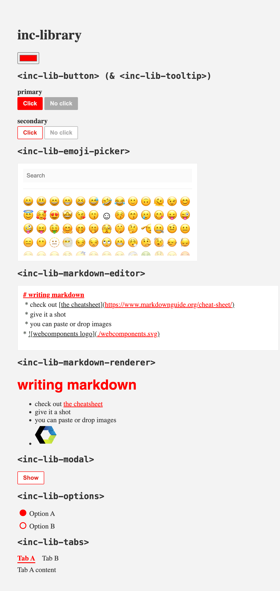

# What?
This is a collection of some generally reusable components made with [@stevvvns/incomponent](../incomponent/README.md) and usable as native webcomponents in any framework



# How?

```
npm i @stevvvns/components
```

Import a component by name:

```javascript
import '@stevvvns/components/button';
import '@stevvvns/components/markdown-editor';
```

Components import their own `.css` and `.svg` as strings, so your bundler needs
text loaders for those extensions.

# Demo

```
npm run demo
```

Open http://localhost:3939 to preview the components (used to regenerate
`screenshot.png`).
